# 06. SAFE SCHOOL 개발자 포트폴리오

> 학교 재난안전 업무의 문제를 현장 교직원이 정의하고, AI 개발 도구(ChatGPT·Claude·Replit)와 협업해 구현·검증한 기록입니다.
> 기록 범위 2026-10-20 ~ 10-22. 화면은 모두 **개발 환경에서 가상 데이터로 촬영**한 것이며, 정식 운영 승인·보안 인증을 받은 시스템이 아닙니다.
> 확인 수준 표시: [확인됨] [사용자 기록] [추정] [확인 필요] — 근거 목록은 `08_근거자료_목록.md`.

---

## 1. 프로젝트 소개
SAFE SCHOOL은 초·중·고등학교 교직원이 **재난 발령 → 학급별 대피 보고 → 학교 전체 현황 파악 → 훈련 기록·한글 문서 작성**을 한 흐름으로 처리하도록 돕는 웹 애플리케이션입니다. 행정안전부 「2026 바이브 코딩 기반 재난안전 분야 업무시스템」 경진대회(제출 마감 2026-11-10) 출품을 목표로 개발하고 있습니다.

| 현재 상태(2026-10-22) | 내용 |
| --- | --- |
| 완료 | STEP 1 ~ 3-D: 학교·교직원, 재난 발령·대피 보고·상황판, 경보함(모의), 안내문, 직책·업무 권한, 훈련일지 자동작성·HWPX |
| 검증 | Replit 자동 테스트 173개 + STEP 3-D E2E 63개 통과, 한컴오피스 열람 확인 [사용자 기록] |
| 예정 | STEP 3-E 통합 안정화, 학교 현장 사용성 검토 |

## 2. 학교 현장에서 발견한 문제
개발자는 학교 교직원으로서 다음 업무 부담을 출발점으로 삼았습니다(10/20 17:30·17:41 지시서 원문의 '업무경감 최우선' 기준).
- 재난·훈련 때 학급별 대피 인원·부재·부상·미확인 학생을 구두·메신저로 모아 다시 정리해야 함
- 발령·종료 시점과 학급 보고 현황을 관리자와 담당자가 같은 화면에서 보기 어려움
- 훈련이 끝나면 일시·참가 인원·학급별 현황을 다시 모아 훈련일지(한글 문서)를 작성해야 함
- 결재(K-에듀파인)와 실제 발송 채널은 학교 기존 절차를 따라야 함 — 새 결재 체계를 만들면 업무가 늘어남(10/21 10:33 원문)

업무 시간 절감률은 측정하지 않았으므로 수치로 제시하지 않습니다.

## 3. 개발 목표와 사용자 정의
| 사용자 | 하는 일 |
| --- | --- |
| 교장·교감(직책) | 발령·종료 판단, 상황판 확인, 훈련일지 열람 |
| 안전업무 담당(업무) | 발령·종료, 훈련일지 작성·한글 파일 출력 |
| 앱 운영담당(업무) | 교직원 승인, 학급·재적, 업무 지정 |
| 담임교사 | 모바일로 담당 학급 대피 보고 |
| 일반 교직원 | 경보함 확인, 배정 시 학급 보고 |

목표 원칙(사용자 지시서 원문에서 반복 확인): 업무경감 우선, 학교 기존 결재·발송 절차 유지, 실제 개인정보 미사용, 미검증 결과를 완료로 적지 않음.

## 4. 시스템 기능 및 업무 흐름
```
(개념도)
관리자·안전업무 담당: 재난 발령(훈련/실제) ──▶ 담임 화면에 담당 학급 보고 자동 열림
담임교사: 대피·부재·부상 입력 → 미확인 자동 계산 → 보고(수정 시 이력)
상황판: 학급별 보고·미보고·미확인·부상 5초 갱신 ──▶ 종료
안전업무 담당: 종료된 모의훈련 → 훈련일지 자동작성 → 담당자 입력(인원·평가·반영사항) → 저장(판 번호) → HWPX 내려받기
                                                     ↳ 한글에서 사진 추가 → K-에듀파인 결재에 직접 첨부
경보(모의): 수집 → 학교 지역 매칭 → 재송출 묶음 → 교직원 경보함 → 안내문 작성 지원(발송은 학교 기존 채널)
```

## 5. 기술 구성과 개발 환경
Node.js·Express 5·React 19·Vite 6·Tailwind 4·Prisma 6·PostgreSQL·Vitest 4, Replit(실행·DB), GitHub(비공개). DB는 스키마로 **자동 테스트용(`safeschool_test`)과 시연용(`safeschool_browser_demo`)을 분리**했고, 테스트는 스키마 이름에 `test`가 없으면 실행을 거부합니다. 상세는 `04_기술_아키텍처_및_기능현황.md`.

## 6. 단계별 개발 과정
| 날짜 | 단계 | 결과 | 대표 커밋 |
| --- | --- | --- | --- |
| 10/20 | STEP 1·2 | 구조·DB, 학교 등록·가입 승인·학급, 디자인 시스템 | `f8f4792` `2535b49` `448370d` |
| 10/20 | STEP 3-A | 발령·대피 보고·상황판 — 자동 150건 + 브라우저 시연 | `2d7c70d` … `90093bf` |
| 10/20~21 | STEP 3-B | 경보 수집·지역 매칭·경보함(모의), 재송출 묶음 버그 수정 | `285edba` … `6667a81` |
| 10/21 | STEP 3-C | 안내문 작성 지원·예시문·취소본 재사용, UI 단순화 — 자동 283건 | `f7884af` `8257b62` |
| 10/22 | STEP 3-D | 서식 설계 → 사용자 결정 → 구현 → Replit 검증 → UI·HWPX 개선 — 자동 173 + E2E 63 | `61a0408` … `054a574` |

## 7. AI 활용 방식
| 도구 | 실제로 맡은 일 |
| --- | --- |
| ChatGPT | 요구사항·SQL 검토, Replit 오류 원인 분석(예: Prisma Client 재생성, 재송출 묶음 원인 추정), Claude 전달용 지시서 작성, 보고서 정리 |
| Claude | 설계 문서, 서버·화면·DB·테스트 코드, 작업공간 검증, 분석 보고, 문서화 |
| Replit | 실제 DB에서 타입 검사·전체 테스트·E2E 실행, 브라우저 시연 |
| 개발자 | 무엇을 만들지·언제 만들지 결정, 결과를 직접 실행·확인하고 다음 지시 |

**협업 방식(기록에서 확인되는 패턴)**
1. 큰 변경은 **설계 → 사용자 검토 → 승인 → 구현** 순서(10/20 17:30 코드 생성 금지, 10/22 09:27 '1차만', 09:46 구현 보류).
2. Claude는 이 작업공간에서 실행할 수 없는 테스트를 '미실행'으로 적고, Replit 실행 명령을 함께 전달.
3. 사용자는 Replit·브라우저 결과(실패 출력 포함)를 그대로 돌려주고, 원인 확인 후 다음 단계로 진행.

## 8. 주요 프롬프트와 개선 과정
원문 위치와 분류는 `02_AI_프롬프트_기록집.md`. 대표 사례:
| 사례 | 처음 | 바뀐 것 | 근거 |
| --- | --- | --- | --- |
| 안내문 범위 | AI 제안: 앱 안 관리자 승인 → 가상 학부모 모의 발송 | 개발자 수정: 승인·발송은 학교 기존 절차(K-에듀파인·기존 채널), 앱은 작성·복사·예시문 지원 | 10/21 10:18 → 10:33·10:34 원문 |
| 취소 안내문 | 설계: 취소본은 수정·삭제·복구 모두 금지 | 개발자 요구: 원본은 그대로 두고 '새 초안 만들기'로 재사용 | 10/21 10:55 원문 4절 |
| 훈련일지 서식 | 시제품 두 가지(1쪽형·붙임형), O/X 선택 표시 | 개발자 결정: 붙임형(학급 수 증가 대비), O/X 빈칸에 직접 쓰기 | 10/22 09:46 원문 |
| 검증 기준 | "테스트 출력 없이 통과 주장 금지" | "미실행 테스트를 통과했다고 기록하지 않기"로 매 지시서에 고정 | 10/20 21:00 → 10/21 09:50 원문 |

## 9. 기술적 문제 해결 사례(요약)
상세는 `03_오류_및_문제해결_사례집.md`(17개 사례).
| 문제 | 해결 | 근거 |
| --- | --- | --- |
| 같은 폭염경보가 2건으로 표시(소재지를 나중에 확인할 때 재송출 묶음 누락) | 묶음 함수 통일 + 재정리 명령 | `6667a81` |
| 1차 SQL이 다른 학교 경보와 안내문 연결을 막지 못함 | 복합 외래키·트리거, SQL 점검 55/55 | `69b14bd` `f7884af` |
| 두 운영자가 동시에 서로를 해제하면 운영자 0명 | 학교 단위 잠금으로 직렬화 | `dfe3cb4` |
| 같은 내용 저장에도 판 번호 증가(jsonb 키 순서) | 키 정렬 비교 | `2499324` |
| 앱 운영담당 자기 지정, 교장·교감 앱 회수 | 서버에서 거부 | `2499324` |
| 역할을 늘리면 HWPX 내려받기 500 | 칸 자동 축소·초과 허용 | `054a574` |
| E2E가 남은 서버에 접속(EADDRINUSE) | 결과 확정 보류 후 서버 처리 수정 | `43d7d5d` |

## 10. 테스트 및 검증 결과
| 시점 | 결과 | 수준 |
| --- | --- | --- |
| 10/20 STEP 3-A | `npm test` 69 + E2E 81 = 150 통과 | [사용자 기록] |
| 10/21 STEP 3-C UI | `npm test` 135 + E2E 148 = 283 통과 | [사용자 기록](콘솔 출력 원문 포함) |
| 10/22 STEP 3-D | `npm test` 173(13개 파일) + `e2e:step3d` 63 통과, Prisma·타입 검사 통과 | [사용자 기록] |
| 10/22 한컴오피스 | 3학급·40학급 훈련일지 열람·인쇄 미리보기, 표 잘림 없음 | [사용자 기록] |
상세·한계는 `05_테스트_및_검증_보고서.md`.

## 11. 실제 작동 화면(개발 환경 · 가상 데이터)
촬영 시점에 따라 가상 학교명과 세부 디자인이 다릅니다.

| | | |
| --- | --- | --- |
| 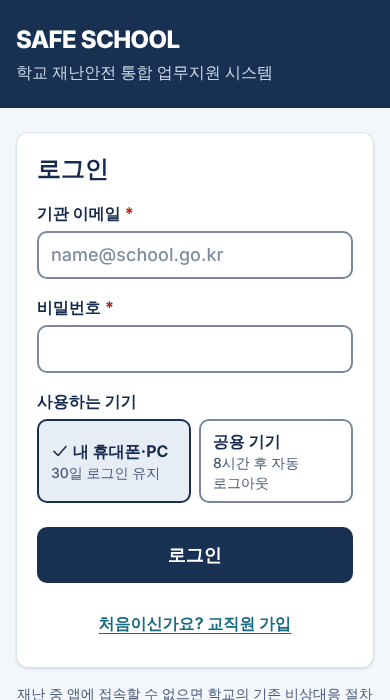<br>[화면 1] 로그인 | 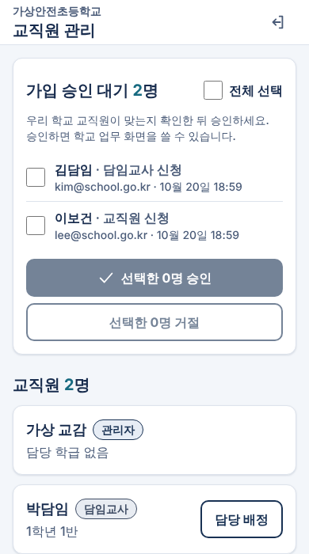<br>[화면 2] 교직원 가입 승인 | 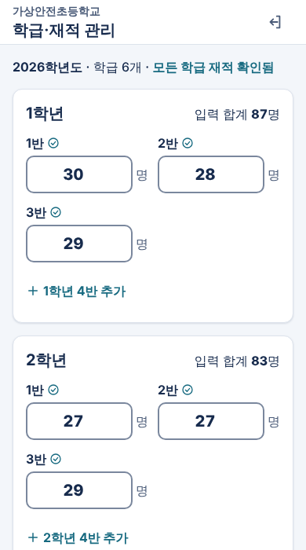<br>[화면 3] 학급·재적 관리 |
| 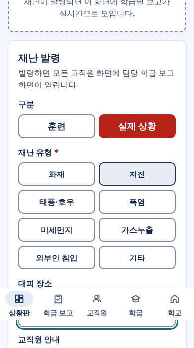<br>[화면 4] 재난 발령 | 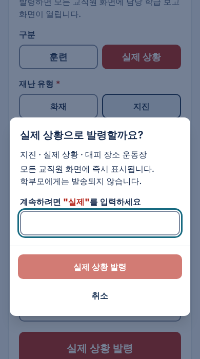<br>[화면 5] 실제 상황 발령 확인 | 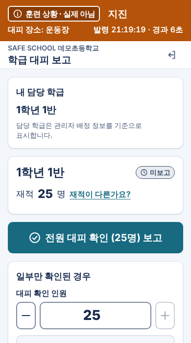<br>[화면 6] 발령 즉시 담임 화면 |
| 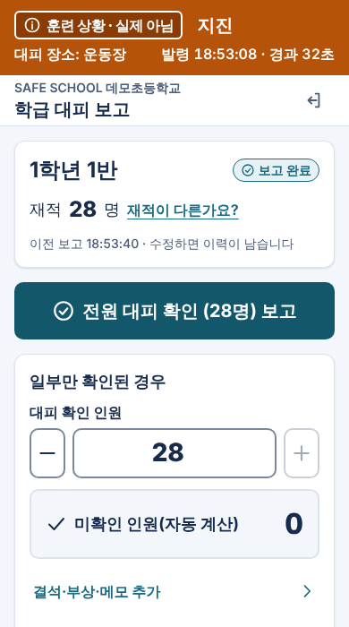<br>[화면 7] 담임 대피 보고 | 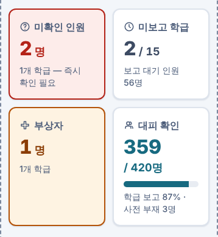<br>[화면 8] 상황판 집계(디자인 미리보기) | 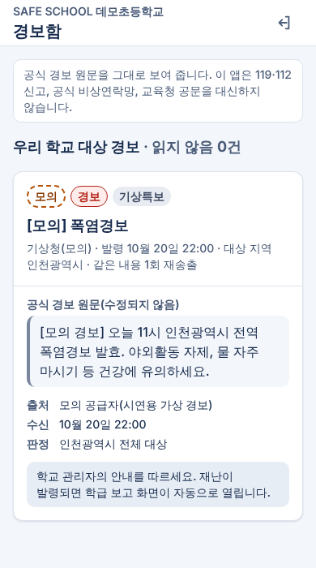<br>[화면 9] 교직원 경보함(모의) |

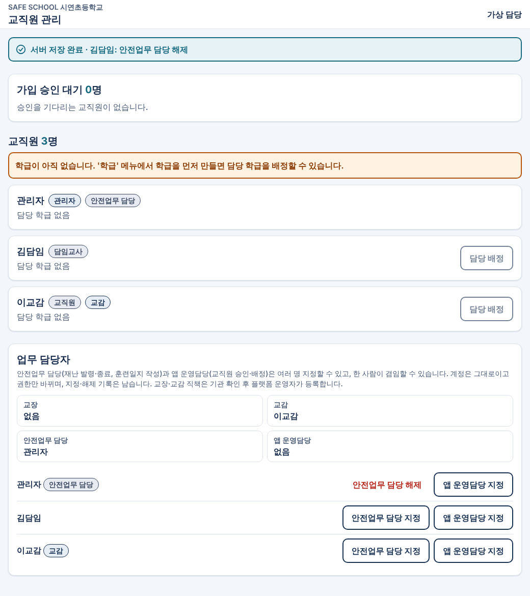
[화면 10] 직책·업무 담당자 지정(PC)

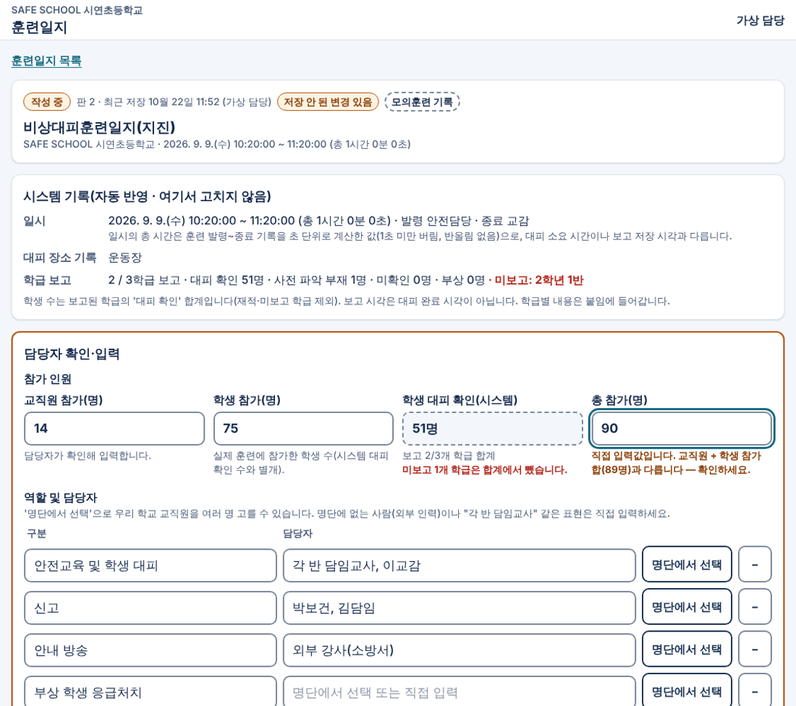
[화면 11] 훈련일지 작성(PC) — 시스템 기록·참가 인원·역할 담당자

| | |
| --- | --- |
| 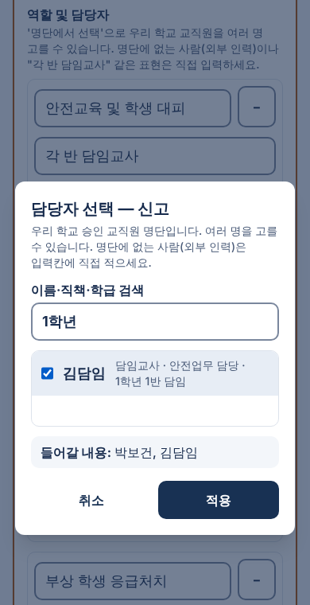<br>[화면 12] 교직원 명단에서 담당자 선택 | 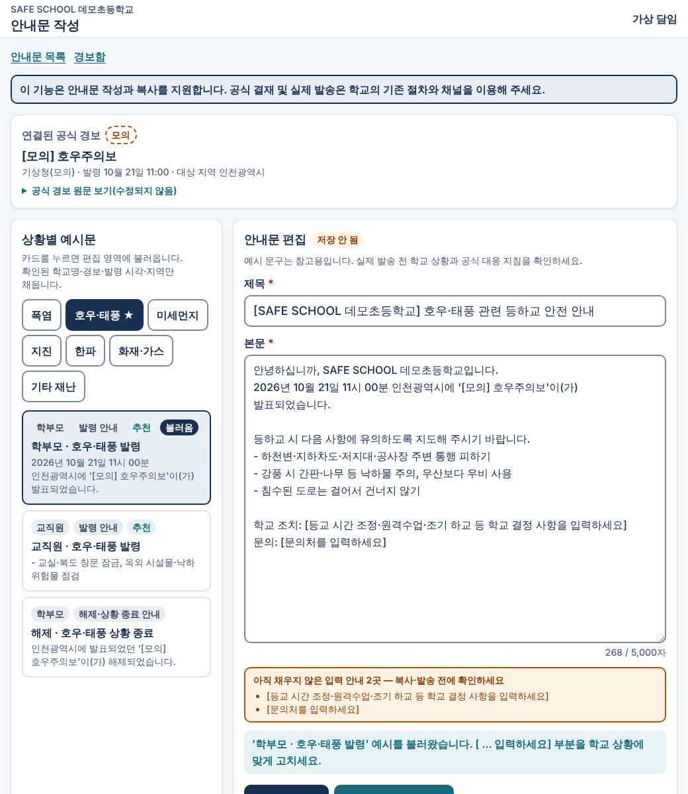<br>[화면 13] 학교 안내문 작성(PC, UI 개선 전) |

| | |
| --- | --- |
| 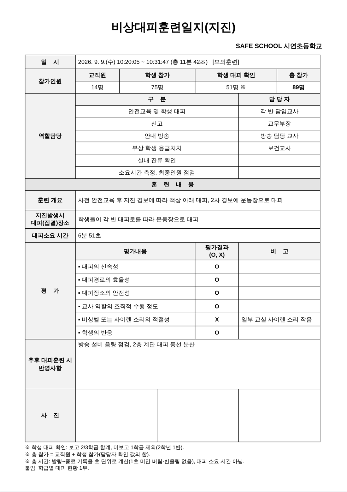<br>[문서 1] 훈련일지 본문(3학급 예시) | 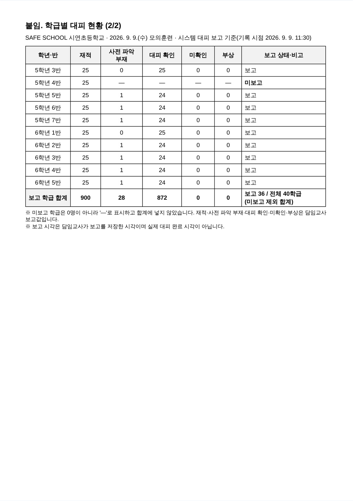<br>[문서 2] 붙임 마지막 쪽(40학급 예시) |
[문서 1·2]는 앱의 A4 미리보기(HWPX와 같은 배치)로, 한글 프로그램 화면이 아닙니다.

## 12. 기대 효과 및 한계
| 현재 확인된 사항(개발 환경) | 기대 효과(현장 검증 전) |
| --- | --- |
| 발령 즉시 담임 화면에 보고 화면이 열림 | 재난 정보 공유의 신속성 |
| 학급별 보고·미보고·미확인 자동 집계 | 대피 현황의 가시성 |
| 종료된 훈련으로 훈련일지 자동작성·HWPX | 훈련 결과 취합·문서 작성 업무경감 |
| 수정 시 판 번호·이전 기록 보존(DB 트리거) | 기록 신뢰성 |

**한계**: 실제 학교 사용자 검증·업무경감 측정 전, 모바일 미리보기 가로 스크롤, 모바일 입력·저장 전체 수동 검증 미실시, 공식 경보 실제 API 미연동, 보안은 개발 단계 시험 수준.

## 13. 향후 개발 계획
STEP 3-E 통합 안정화(모바일 미리보기 개선, 모바일 수동 점검, 통신 장애 대응 재확인) → 경진대회 제출(11/10) → 학교 협의 후 사용성 검토(가상 데이터) → 안전교육·시설 점검 등 후속 기능 검토 → 운영 전 보안·개인정보 점검 → 외부 연동은 기관 승인 후.

## 14. 개발자의 역할과 성장 과정
AI가 코드를 썼지만, **무엇을·어떤 조건으로 만들지와 결과가 맞는지는 개발자가 판단**했습니다. 아래는 기록으로 확인되는 것만 적었습니다.

| 역할 | 기록으로 확인되는 행동 | 근거 |
| --- | --- | --- |
| 현장 문제 발굴 | 업무경감 최우선 지침, 학교 실제 훈련 문서 4종 제공 | 10/20 17:41 원문, 10/22 09:27 원문 |
| 요구사항 정의 | 첫 가입자 자동 관리자 금지, 10개 시나리오 | 10/20 18:17 원문 |
| 우선순위 결정 | 3-B 순서(수집→지역→중복→알림), 3-D 비상대피훈련일지 우선 | 10/20 21:51, 10/22 09:27 원문 |
| 업무 절차 설계 | 결재·발송은 기존 절차 유지, 예시문·취소본 재사용 | 10/21 10:33·10:55 원문 |
| 권한 정책 결정 | 교장 1·교감 최대 2·업무 겸임, 검증 안 된 관리자 자동 승격 금지 | 10/22 10:00·10:18(원문 미확보, AI 요약) + DB 제약으로 구현 [확인됨] |
| 데이터 보호 요구 | 시연 DB 초기화 금지, 테스트·시연 DB 혼용 금지, 원문 경보 수정·삭제 금지, 학부모 자동 발송 금지, 실명·연락처 미사용 | 10/21 09:50 원문 6절, 10/22 09:27 원문 |
| AI 결과 검증 | Replit 실행·실패 출력 전달, 브라우저 시연, 한컴오피스 확인 | 10/20 21:19·21:51, 10/21 19:49, 10/22 14:33 |
| 사용성 확인 | 저장 단추 혼란 제기, PC 화면·참가 인원 칸 개선 요구 | 10/21 19:27 원문, 10/22 11:40(원문 미확보) |
| 오류 분석·수정 방향 | 재송출 경보 버그를 실제 순서로 재현해 보고 | 10/21 09:50 원문 3-8·4절 |
| 결과 평가·후속 요구 | 서식 결정(붙임형·O/X 빈칸), 구현 보류·재개 지시, 한계 명시 요구 | 10/22 09:46 원문, 14:33 원문 |

**성장 과정(기록에서 보이는 변화)**: 첫날에는 기능 단위 요청 중심이었으나, 둘째 날부터 SQL을 DB 적용 전에 따로 검토·승인하는 단계를 두었고, 셋째 날에는 '분석 보고 → 승인 → 최소 변경 구현'과 '기존 데이터·마이그레이션 보존'을 지시서의 고정 조건으로 사용했습니다.
